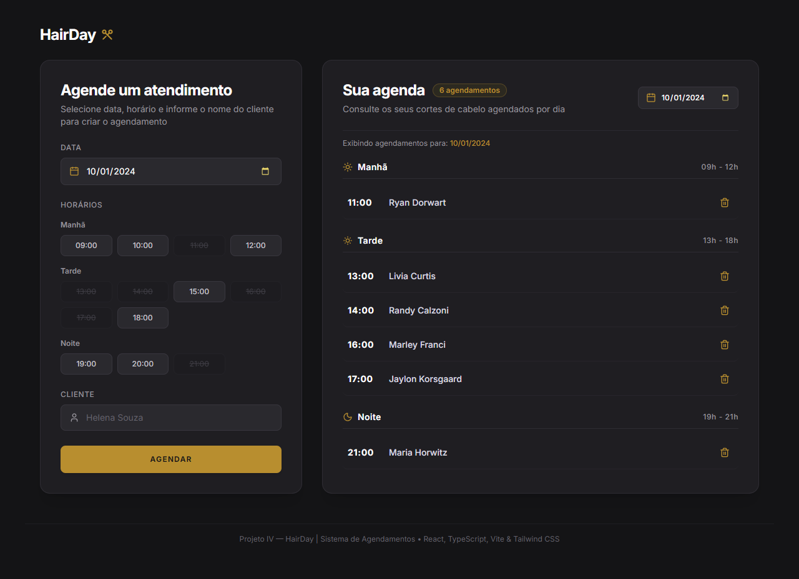
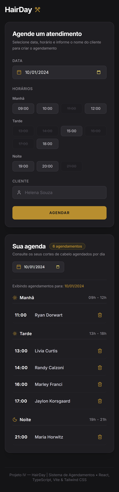

# ✂️ HairDay — Sistema de Agendamentos

> **Projeto 04 — HairDay | Sistema de Agendamentos com React + TypeScript + IA**  
> **Disciplina:** Single Page Application (SPA)  
> **Tecnologias:** React 18, Vite, TypeScript, Tailwind CSS, Playwright, Context API  
> **Ferramentas de IA:** OpenCode / Antigravity AI, Context7 MCP, Playwright MCP, Figma  

---

## 📌 Sumário
- [Sobre o Projeto](#-sobre-o-projeto)
- [Demonstração Visual (Screenshots)](#-demonstração-visual-screenshots)
- [Funcionalidades Principais](#-funcionalidades-principais)
- [Conceitos React & TypeScript Aplicados](#-conceitos-react--typescript-aplicados)
- [Arquitetura e Estrutura de Pastas](#-arquitetura-e-estrutura-de-pastas)
- [Uso de Ferramentas de IA e MCPs](#-uso-de-ferramentas-de-ia-e-mcps)
- [Como Executar o Projeto](#-como-executar-o-projeto)
- [Testes Automatizados (Playwright)](#-testes-automatizados-playwright)

---

## 📖 Sobre o Projeto

O **HairDay** é uma aplicação web moderna para gestão de agendamentos em barbearias e salões de beleza, desenvolvida com base no protótipo oficial do Figma. 

A aplicação permite que o profissional e seus clientes visualizem os cortes de cabelo agendados para qualquer data, realizem novos agendamentos com validação estrita de horários e excluam agendamentos com atualização instantânea na interface.

* **Protótipo Oficial do Figma:** [Plataforma de agendamento — Community](https://www.figma.com/design/0UAXn1uIaIWTUDnBj1Tzct/Plataforma-de-agendamento--Community---Copy-?node-id=3-376)
* **Enunciado no Notion:** [Projeto 04 — HairDay no Notion](https://deluxe-blue-bc1.notion.site/Projeto-04-HairDay-Agendamentos-com-React-TypeScript-IA-414dfca74d8d81919380c39dcde5d2e3?pvs=74)

---

## 🖼️ Demonstração Visual (Screenshots)

### Versão Desktop


### Versão Mobile
<p align="center">
  
</p>

---

## ✨ Funcionalidades Principais

1. **Agendamento Completo:**
   - Seleção de data via seletor com formato brasileiro (`DD/MM/YYYY`).
   - Seleção intuitiva de horários divididos por períodos.
   - Bloqueio visual e funcional de horários já agendados para a data selecionada.
   - Input de nome do cliente com ícone e placeholder condizentes ao Figma.
2. **Organização por Três Períodos do Dia:**
   - **Manhã:** 09h às 12h (slots: 09:00, 10:00, 11:00, 12:00)
   - **Tarde:** 13h às 18h (slots: 13:00, 14:00, 15:00, 16:00, 17:00, 18:00)
   - **Noite:** 19h às 21h (slots: 19:00, 20:00, 21:00)
3. **Mensagem de Período Vazio:**
   - Quando não há agendamentos em um período para o dia selecionado, uma mensagem amigável é exibida ("*Nenhum agendamento para este período*").
4. **Exclusão Rápida:**
   - Botão com ícone de lixeira dourada permitindo remover agendamentos instantaneamente.
5. **Filtragem por Data:**
   - Seletor de data no topo da agenda para alternar entre dias e visualizar os respectivos compromissos.
6. **Persistência Local (LocalStorage):**
   - Agendamentos são persistidos no navegador, não sendo perdidos ao recarregar a página.
   - Vem pré-populado com os agendamentos idênticos ao protótipo do Figma na data `10/01/2024`.

---

## 🧠 Conceitos React & TypeScript Aplicados

### 1. Hooks & Context API (`useState`, `useEffect`, `useContext`)
- O estado global da agenda é centralizado em `ScheduleContext.tsx` e acessado através do custom hook `useSchedule()`.
- O `useState` gerencia tanto a lista de agendamentos quanto a data atualmente ativa.
- O `useEffect` sincroniza qualquer alteração no estado diretamente com o `localStorage`.

### 2. Componentização & Props
- A aplicação foi dividida em componentes reutilizáveis e desacoplados:
  - `Header`: Logotipo e identidade visual.
  - `BookingForm`: Formulário lateral de marcação.
  - `TimeSlotSelector`: Grade de horários por período com detecção de slots livres/ocupados.
  - `ScheduleView`: Painel principal da agenda com contador e filtro de data.
  - `PeriodSection`: Seção dedicada para cada período do dia (Manhã, Tarde, Noite).
  - `AppointmentCard`: Cartão individual de agendamento com botão de lixeira.
  - `Toast`: Notificação flutuante de sucesso e erro.

### 3. Funções de Alta Ordem: `map()`, `filter()` e `reduce()`
O projeto utiliza extensivamente os métodos nativos de arrays exigidos na disciplina:
- **`filter()`**:
  - Filtrar agendamentos pela data selecionada:
    ```typescript
    appointments.filter((appointment) => appointment.date === date);
    ```
  - Excluir um agendamento pelo seu ID:
    ```typescript
    appointments.filter((appointment) => appointment.id !== id);
    ```
  - Obter os horários ocupados para desabilitar botões:
    ```typescript
    appointments.filter((apt) => apt.date === date).map((apt) => apt.time);
    ```
- **`map()`**:
  - Renderização das seções de períodos (`PERIOD_CONFIGS.map(...)`).
  - Renderização dos botões de horários (`period.slots.map(...)`).
  - Renderização dos cartões de agendamento na lista (`appointments.map(...)`).
- **`reduce()`**:
  - Agrupamento dinâmico dos agendamentos em um objeto por período (`morning`, `afternoon`, `night`):
    ```typescript
    export function groupAppointmentsByPeriod(appointments: Appointment[]) {
      return appointments.reduce((acc, curr) => {
        acc[curr.period].push(curr);
        return acc;
      }, { morning: [], afternoon: [], night: [] });
    }
    ```
  - Cálculo do total de agendamentos e resumo diário:
    ```typescript
    appointments.filter((apt) => apt.date === date).reduce((acc) => acc + 1, 0);
    ```

### 4. Tipagem TypeScript
Tipos bem definidos em `src/types/appointment.ts`:
```typescript
export type PeriodType = 'morning' | 'afternoon' | 'night';

export interface Appointment {
  id: string;
  clientName: string;
  date: string;
  time: string;
  period: PeriodType;
  createdAt: string;
}

export interface NewAppointmentDTO {
  clientName: string;
  date: string;
  time: string;
}
```

---

## 📂 Arquitetura e Estrutura de Pastas

```
Projeto-IV-HairDay/
├── docs/
│   └── screenshots/              # Capturas desktop e mobile geradas pelo Playwright
│       ├── desktop.png
│       └── mobile.png
├── src/
│   ├── components/
│   │   ├── Header.tsx            # Header com logo HairDay
│   │   ├── Toast.tsx             # Feedback de notificação reutilizável
│   │   ├── Sidebar/
│   │   │   ├── BookingForm.tsx   # Formulário de novo agendamento
│   │   │   └── TimeSlotSelector.tsx # Grade de slots com estado ocupado/livre
│   │   └── Schedule/
│   │       ├── ScheduleView.tsx  # Visão geral da agenda e filtro de data
│   │       ├── PeriodSection.tsx # Seções: Manhã, Tarde e Noite
│   │       └── AppointmentCard.tsx # Item individual com botão de exclusão
│   ├── context/
│   │   └── ScheduleContext.tsx   # Contexto global da aplicação
│   ├── hooks/
│   │   └── useSchedule.ts        # Custom Hook de consumo do contexto
│   ├── types/
│   │   └── appointment.ts        # Interfaces e types TypeScript
│   ├── utils/
│   │   ├── dateUtils.ts          # Formatação e manipulação de datas
│   │   └── periodUtils.ts        # Lógica de períodos e reduce()
│   ├── App.tsx                   # Componente raiz com layout responsivo
│   ├── main.tsx                  # Ponto de entrada com ScheduleProvider
│   └── index.css                 # Configuração Tailwind CSS
├── tests/
│   └── hairday.spec.ts           # Suíte de testes E2E do Playwright
├── AGENTS.md                     # Diretrizes para Agentes de IA (obrigatório)
├── playwright.config.ts          # Configuração dos testes Playwright
├── tailwind.config.js            # Design tokens e paleta do Figma
├── tsconfig.json                 # Configuração do compilador TypeScript
└── package.json                  # Dependências e scripts do projeto
```

---

## 🤖 Uso de Ferramentas de IA e MCPs

Este projeto foi conduzido seguindo as práticas de Pair Programming Assistido por Inteligência Artificial:

1. **Arquivo `AGENTS.md`:**
   - Criado na raiz do repositório contendo todas as diretrizes técnicas, arquiteturais, convenções de código e escopo do HairDay para orientar agentes autônomos.
2. **Context7 MCP:**
   - Utilizado para consultas em tempo real da documentação de React 18, TypeScript 5, Vite e melhores práticas da Context API.
3. **Playwright MCP:**
   - Utilizado para executar testes automatizados End-to-End, garantindo que o fluxo de agendamento, validação e exclusão funcione com fidelidade ao protótipo e gerando as evidências visuais (`desktop.png` e `mobile.png`).

---

## 🚀 Como Executar o Projeto

### Pré-requisitos
- Node.js versão 18+ ou superior instalada.
- Gerenciador de pacotes `npm` ou `yarn`.

### Passo a Passo

1. **Clone o repositório:**
   ```bash
   git clone https://github.com/CauaBrandao/Projeto-IV-HairDay.git
   cd Projeto-IV-HairDay
   ```

2. **Instale as dependências:**
   ```bash
   npm install
   ```

3. **Inicie o servidor de desenvolvimento:**
   ```bash
   npm run dev
   ```
   Acesse a aplicação no navegador em: `http://localhost:5173`

4. **Gerar build de produção:**
   ```bash
   npm run build
   ```

5. **Visualizar o build gerado:**
   ```bash
   npm run preview
   ```

---

## 🧪 Testes Automatizados (Playwright)

Para rodar toda a suíte de testes E2E e validar o funcionamento nos ambientes Desktop e Mobile:

```bash
npm run test:e2e
```

Todos os 8 testes executados cobrem:
- Fidelidade visual e carregamento dos componentes.
- Carregamento inicial dos agendamentos nos três períodos.
- Validação e cadastro de novos agendamentos em tempo real.
- Exclusão via botão de lixeira e exibição de aviso de período vazio.
- Geração automática das capturas em `docs/screenshots/`.

